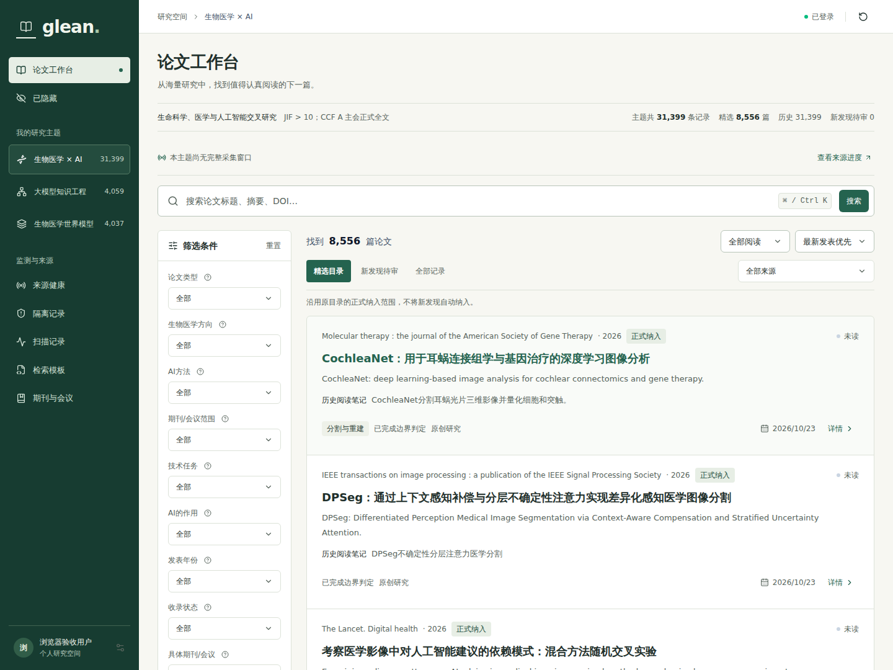
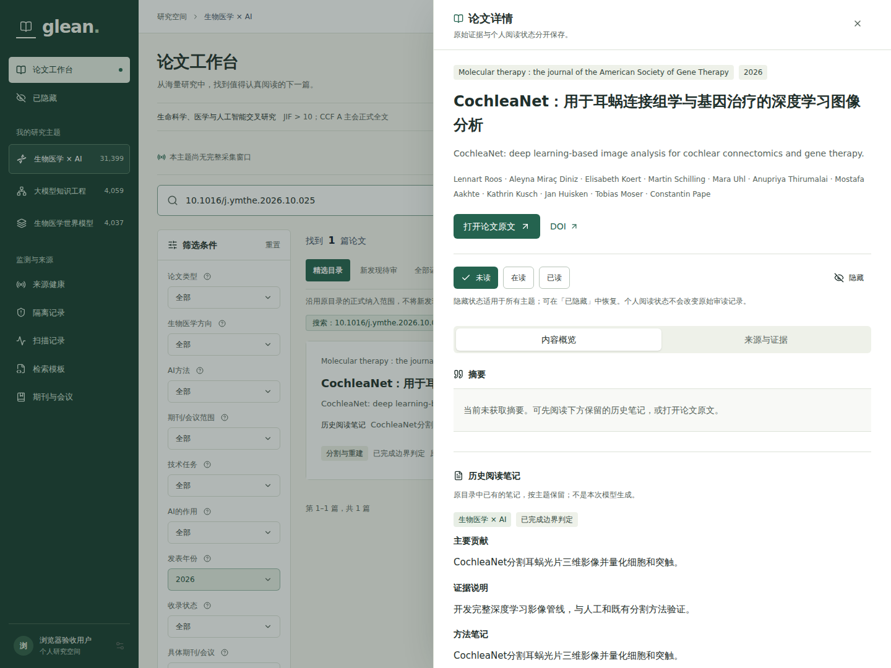
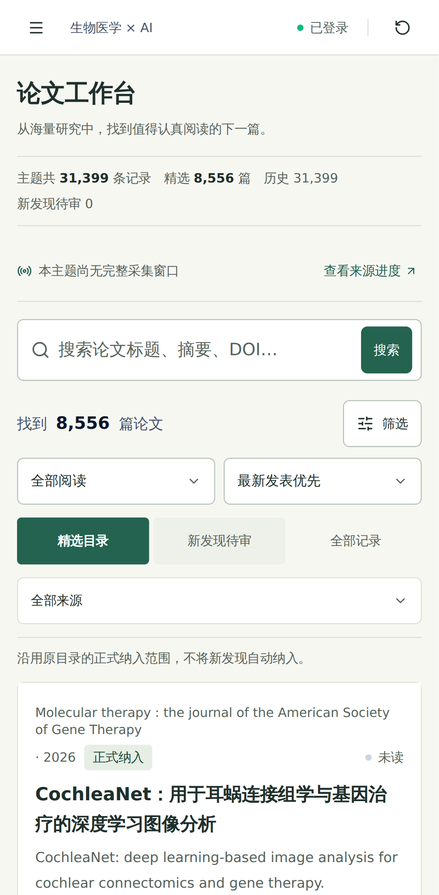

# Glean Web

以中文阅读为优先的文献检索与研究工作台。基于 **React 19 + TypeScript + Vite**、**Tailwind CSS v4**、可编辑的 **shadcn/ui 开放源码组件与 Radix 基础组件**，配合 Lucide 图标和 TanStack Query 构建。

## 界面设计方法

本次重构选择 [Impeccable](https://github.com/pbakaus/impeccable) 的 Operate / Read 方法，而不是叠加两套设计工具。深色任务导航、紧凑的主题信息、连续题录列表和前置的原文入口共同服务于检索与阅读；认证、精确筛选、个人状态和科学证据逻辑保持不变。

产品事实与交互边界见 [PRODUCT.md](PRODUCT.md)，视觉 token、响应式规则和方法版本见 [DESIGN.md](DESIGN.md)。本项目采用其设计指导，没有安装其运行时、浏览器扩展或 hooks，也不声称通过了其 CLI 检测。

## 运行界面

以下截图来自真实运行的前端、Go API 和 PostgreSQL，使用已提交的历史文献数据，不是设计稿或模拟页面。

### 桌面端：论文工作台

三个研究主题、中文优先的连续题录、多维筛选、目录范围与个人阅读状态集中展示。截图中主题总量为 31,399 条，精选目录为 8,556 篇；两种统计口径不同。



### 桌面端：论文详情

详情抽屉前置原文入口，将个人阅读状态、原始历史笔记与模型处理结果分开。尚未获取的摘要明确显示为空，不用历史笔记或模型输出冒充原文摘要。



### 手机端：文献浏览

窄屏将导航与筛选收进弹窗，保留检索、目录切换和论文卡片。



截图记录：2026-10-27，[提交 `bd20fb4`](https://github.com/TeamSillyBees/glean/commit/bd20fb4a5be5cae300a1c8cf6f15cdfc07db5d2f) 的 [GitHub Actions 运行 40531139041](https://github.com/TeamSillyBees/glean/actions/runs/40531139041)，来自 Chromium 桌面端与 Pixel 7 尺寸的移动端浏览器验收。图片为原始视口截图，仅更名复制；详细来源见[截图说明](docs/screenshots/README.md)。该次常规 CI 全部通过，另完成 320–1920px 七档目录布局检查；截图展示历史库界面，不代表实时采集验收结果，也不代表正式上线。该次截图中的 LLM 为明确标识的 mock，历史笔记不是模型生成结果；当前流程见[论文处理说明](../docs/glean/paper-pipeline.md)。

上述截图记录的是该提交的阅读界面，尚未展示新增的用户管理、研究主题与论文管理界面；不能据此认定管理模块已完成浏览器验收。

## 简单管理

- **用户管理**（管理员）：搜索账号，新建或编辑昵称、管理员/普通用户类型和启用状态。创建时设置初始密码；不提供自行注册、密码重置或删除按钮，保留已有角色授权。
- **论文管理**（详情内，管理员）：按当前主题明确选择待审、纳入或移出，附备注与标签；移出可恢复，不删除论文。书目纠错只编辑勾选的六项字段，填写原因后保存；取消勾选后保存可恢复来源值。修改历史展示最近 100 条。
- **研究主题**（管理员）：一张表单创建或编辑名称、说明、纳入规则、检索词组与后续扫描开关。保存后出现在主题导航，不启动扫描或全局调度。
- **高级检索路线**（主题表单）：编辑或粘贴最多 20 条路线的 JSON，配置来源、词组、字段模式与历史起点。路线之间取并集，旧词组仍保留；清空路线恢复旧模板。保存不启动采集。
- **编译预览与查询覆盖**：检索模板页展示已保存配置的各源表达式、独立种子查询与来源限制，不发起外部采集。扫描记录区分整体范围和当前分区，展示未启用路线、预算耗尽、空结果完成及不推进增量检查点的情况；旧记录不推断完整性。论文来源详情显示发现路径，超过 100 条明确提示截断。
- **个人阅读**（所有登录用户）：阅读状态、隐藏和筛选偏好按用户隔离；个人隐藏跨主题生效，与共享的移出主题不同。

普通用户可查看共享审核结论、标签和备注，但看不到管理写入控件。首次人工决定必须明确选择，不替历史不确定记录自动下结论。并发冲突时页面提供重新读取，不要求用户维护版本号。详细步骤与边界见[管理指南](../docs/glean/management.md)。

## 本地运行

需要 Node 24 和 npm 11；仓库中的锁文件固定已解析的依赖版本。

```bash
cd web
npm ci
cp .env.example .env.local
npm run dev
```

Vite 开发服务器默认绑定 `127.0.0.1:5173`，将 `/api` 代理到 Go 后端 `http://127.0.0.1:8080`。后端端口不同时可修改 `GLEAN_API_PROXY`。生产环境应托管 `dist/` 并在同源下反向代理 `/api`；若使用独立的 `VITE_API_BASE_URL`，必须同时明确配置后端 CORS 白名单。不要在 `VITE_*` 变量中放置密钥、token 或密码。

按照[仓库根目录说明](../README.md#本地启动)完成 Go 后端配置、迁移和账号 seed，再使用该账号登录。前端不内置示例密码。Access token 与 refresh token 仅保存在模块内存中，不写入浏览器存储；刷新页面后需要重新登录，这是有意设置的安全边界。

```bash
npm run typecheck
npm run lint
npm test
npm run build
npm run format:check
npm run preview
```

`npm run preview` 用于预览已构建的 `dist/`，不替代正式生产服务器。

## 架构与数据边界

- 业务数据来自经过认证的 `/api/v1/catalog/*`、`/api/v1/monitor/*`，沿用 initra 的统一响应结构。详见 [API 契约](../docs/glean/api-contract.md)。
- 前端提供查询、阅读及受权限保护的管理操作，不自行采集外部来源、启动扫描、调用 LLM、自动推断科学分类或编造实时计数。
- **不存在静默回退到演示数据的行为。** 后端错误有明确的重试状态。可预测且明确标记的模拟数据只用于测试；旧 mock 输出仍明确标识；新处理流程显示材料范围、模型阶段及待配置状态，不把真实来源论文标成假数据。
- `src/lib/filters.ts` 将各主题原有的筛选维度映射为查询参数。选项值与分类来自后端 facets，不使用前端启发式推断。世界模型主题的 `display_*` 值由后端从原始 HTML 分类中导入。
- 默认范围为后端定义的精选目录（`curated`），另有待审核、已移出主题和全部记录；全部记录包含历史背景及范围外条目。主题总数始终标为总记录数，而非精选数量。筛选项加载中、可重试错误和确实缺少标签是不同状态。
- 历史筛选顺序：论文类型 → 方向 → **AI 方法（仅生物医学 AI）** → 期刊/会议范围 → 技术任务 → 模型作用 → 年份 → 收录状态 → 具体期刊/会议。生物医学 AI 的 9 项及另外两主题的 8 项筛选均可见；通过搜索精确后端标签，仍能找到低频选项。**科学审核证据**独立于用户的**未读 / 在读 / 已读**状态。
- 首次查询论文前先加载个人偏好，保存操作需显式执行。个人隐藏的论文默认排除，可在独立的已隐藏视图中恢复；这些操作不修改原始元数据。
- 正式在线日期与卷期日期分别展示。缺失日期保持待核，录用、投稿或索引日期不冒充发表日期。
- 来源证据链接仅接受 HTTP(S)，新窗口使用 `noopener noreferrer`；原始证据按转义文本渲染。
- 论文详情支持 `?paper=<字符串 ID>` 分享链接，登录后打开；刷新后仍需登录但目标保留。复制链接仅包含论文 ID，不含搜索、笔记、标签或令牌。个人隐藏不是访问控制，直达隐藏论文不会取消隐藏。列表打开详情后 Back/Forward 保留当前内存筛选和页码；直接落地链接的关闭操作仅移除 URL 中的论文目标，不返回外站。
- 会话代次隔离可防止延迟刷新、退出、过期 401 响应及延迟 JSON 解析跨账号污染状态。

## 按需加载与构建记录

论文工作台、论文详情的无障碍弹窗外壳与密码对话框保留在首屏；论文详情正文（含证据与论文管理）仅在打开详情时加载。用户、主题管理、隔离记录、来源详情和监控页面在打开时加载。来源进度条与共享查询独立于详情模块，管理表单样式也不再经主题页面间接导入。扫描记录、检索模板与期刊登记暂共用一个延迟模块，不为每个小页面增加拆分配置。

加载状态通过 `role="status"` 提示；页面加载或渲染失败在内容区域提供重试，导航与当前内存会话仍保留。离开页面后，迟到的模块结果不会把用户带回旧页面。重试重新创建该页的 lazy 实例，不刷新整个应用；若部署已删除旧资源，仍可能需要用户刷新并重新登录，不能承诺所有资源错误仅靠重试恢复。

2026-11-01 在相同锁文件和 Vite 8.3.5 下实际运行 `npm run build`，比较原 main 树（本地 `95bdee9`，对应远端 `daaa529` 的文件树）与本次改动。单位为构建器报告的十进制 kB，gzip 为 Vite 报告值；不是网络计时或浏览器性能验收：

| 生产资源 | 改动前 | 改动后 |
| --- | ---: | ---: |
| 首次加载 JS（入口 + HTML modulepreload） | 550.58 / gzip 168.60 | 511.73 / gzip 161.57 |
| 其中入口 JS | 550.58 / gzip 168.60 | 432.64 / gzip 134.01 |
| 其中首屏共享 JS | 无独立块 | 79.09 / gzip 27.56 |
| 延迟 JS 合计 | 无独立块 | 45.36 / gzip 18.07 |
| CSS | 39.96 / gzip 8.98 | 39.96 / gzip 8.98 |

上述第一阶段首屏仍包含 React、Radix 和论文详情；拆分降低首屏下载，但所有页面合计 JS 略有增加。没有提高告警阈值，也不把单个入口低于 500 kB 当作性能达标。资源哈希随内容变化，不用哈希名作为测试契约。

第二阶段将论文卡片与详情正文拆开，标题、说明、固定关闭按钮和焦点返回始终由首屏弹窗外壳管理。加载或资源错误不会移除弹窗外壳；可关闭、Escape 退出或在原弹窗内重试。关闭、快速切换论文或退出登录后，迟到的模块不会重新打开旧详情；个人状态写入继续使用原有查询归属检查与跨重开并发保护。

同日对实际前置提交 `de892d4` 的干净归档与本次文件树分别构建（同一锁文件、Node 与 Vite），用 `npm run build:size` 读取 HTML 的入口及 modulepreload，并递归统计所有静态 import/export 依赖、去重，动态 import 不计入首屏。此处 gzip 统一使用 Node `gzipSync` 默认参数逐资源压缩后相加，与上表 Vite 报告口径分开；单位仍为十进制 kB。

| 生产资源 | 第二阶段前 | 第二阶段后 |
| --- | ---: | ---: |
| 首次加载 JS（完整静态闭包） | 512.469 / gzip 160.258 | 475.740 / gzip 151.168 |
| 其中入口 JS | 433.378 / gzip 132.952 | 374.971 / gzip 116.476 |
| 其中首屏共享 JS | 79.091 / gzip 27.306 | 100.769 / gzip 34.692 |
| 延迟 JS 合计 | 45.384 / gzip 18.073 | 84.128 / gzip 30.281 |
| CSS | 39.964 / gzip 8.898 | 39.964 / gzip 8.898 |

首屏实际减少 36.729 kB（7.2%），gzip 减少 9.090 kB（5.7%）；全部 JS 由 557.853 增至 559.868 kB。共享块仍有约 21.7 kB 被首屏引用，不能把它计作延迟下载。前置提交包含第一阶段后的修复，因此其基线与上表历史记录略有差异。未提高构建告警阈值，也不声称这些资源体积是网络耗时或浏览器性能成绩。

复核方法：在目标文件树运行 `npm run build && npm run build:size`；比较旧树时可传入其构建路径：`npm run build:size -- /path/to/old/dist`。脚本会列出每个资源、字节数与压缩字节数。真实 API 浏览器验收额外观察生产详情资源只在首次打开时请求，不拦截或伪造资源/API；本地 DOM 测试覆盖延迟导入、关闭、重试、切换论文及账户，不能替代 CI 浏览器执行。

未筛选且主题接口成功确认总记录为零时，论文区解释当前尚无论文、保存主题不会启动扫描，并提供来源进度入口；暂停检索单独说明。零记录不等于从未扫描。已有记录但没有精选时，优先引导到待审核（仅后端候选计数大于零），否则到全部记录。已隐藏、查询错误及带筛选的空结果不套用新主题说明。侧栏改称「共享研究主题」，避免与个人阅读偏好混淆；详情已有共享审核与个人隐藏提示，不重复增加说明。

## 界面能力

动态研究主题导航（保留三个内置主题）；字面检索与键盘聚焦快捷键（`⌘K` / `Ctrl+K`）；后端计数；已选条件标签；分页；个人阅读与隐藏状态；来源证据抽屉；来源健康；扫描历史；检索模板；版本化期刊与会议登记表；只读隔离记录及安全证据预览。

扫描失败卡片可展开只读恢复诊断，区分暂时失败、退避等待、访问受限与已创建恢复运行，并按唯一运行 ID 跳转关联记录。页面不会发起恢复；显示的 CLI 参数仅供管理员核对，实际执行仍须后端校验。

窄屏使用 Radix 弹窗呈现导航和筛选。弹窗支持 Escape 关闭、焦点约束和关闭后的焦点返回；遵循用户的减少动态效果偏好。

## 组件归属

[组件来源与上游登记说明](COMPONENTS.md)保留了 MIT 许可声明。`src/components/ui/` 使用 shadcn/ui 的开放源码组件模式，按本工作台需求调整；组件实际基于 `radix-ui` 的 Dialog、Select、Tabs、Tooltip 和 Slot，结合 Tailwind 工具类与 CVA 变体。

`components.json` 保留标准 shadcn 路径别名和主题配置。组件是可直接维护的源码，不是封闭的组件封装。

参考文档：

- [shadcn/ui 与 Tailwind v4](https://ui.shadcn.com/docs/tailwind-v4)
- [shadcn/ui 的 Vite 安装说明](https://ui.shadcn.com/docs/installation/vite)
- [Radix Dialog 无障碍支持](https://www.radix-ui.com/primitives/docs/components/dialog)
- [Vite 入门](https://vite.dev/guide/)

## 验证范围

### 组件与接口契约测试

Vitest + Testing Library 覆盖认证查询、精确分类参数传递、已保存偏好的恢复、加载/错误/空状态切换、重复打开和关闭详情、阅读/隐藏状态变更与恢复、只读监控、隔离记录、键盘检索及会话竞态隔离。这些测试中的网络数据均显式模拟，属于 DOM 功能测试，不能代替真实浏览器与后端端到端验收。

`src/test/deployment.test.ts` 检查容器部署文件的不变量，不能单独证明容器已成功运行。真实镜像构建、容器启动与反向代理行为由 CI 的容器任务另行验证。

### 真实 API 浏览器验收

`npm run test:e2e:list` 只列出桌面/手机验收测试，不启动浏览器；列举成功不等于实际执行通过。

`npm run test:e2e` 用于具备隔离依赖的 GitHub Actions runner：使用生产 Vite 构建与 preview、真实 Go API、PostgreSQL 和完整历史数据导入，不伪造 API 响应、不注入 token，也不使用假论文。CI 通过 `GLEAN_E2E_USERNAME`、`GLEAN_E2E_SECOND_USERNAME`、`GLEAN_E2E_PASSWORD` 提供临时测试账号，通过 `GLEAN_API_PROXY` 指定后端代理。

测试截图作为 CI artifact 保存，不采集可能携带 token 的 trace/HAR。不要提交 `test-results/`、`playwright-report/` 或认证状态。本文档中的截图是从 CI artifact 人工检查后选出的少量静态图片，单独保存在 `docs/screenshots/`。

真实浏览器验收区分常规回归与外部服务集成：

1. [**常规 CI**](../.github/workflows/ci.yml)：完整导入 39,495 条主题成员关系，验证真实数据库上的登录、查询、阅读/隐藏持久化、账号隔离，以及桌面/手机交互。测试使用仓库中已固定的历史数据，不依赖外部文献服务当时是否可用。
2. [**手动实时验收**](../.github/workflows/live-source-acceptance.yml)：在 GitHub Actions 中单独触发实时集成工作流，有限请求一条 Europe PMC 真实记录，验证采集、持久化以及浏览器中的来源展示。上游不可用时该验收明确失败，不使用模拟记录替代，也不让这项外部依赖阻断常规 CI。

常规 CI 通过不等于外部来源实时可用，实时验收结果也不能代替历史库回归。最新状态请以相应提交的 [Actions 结果](https://github.com/TeamSillyBees/glean/actions)为准。截图中的内容不能作为单篇论文已重新科学核验的证明。

## 容器运行

从仓库根目录构建，**构建上下文必须为 `web/`**：

```bash
docker build --pull -t glean-web:local ./web
```

多阶段镜像先使用官方 `node:24-bookworm-slim` 构建，再将 `dist/` 复制到官方 `nginx:stable-alpine`。运行阶段使用非 root 的 `nginx` 用户，监听 **8080** 端口；镜像构建过程中通过 `RUN nginx -t` 验证配置。上游镜像标签会接受维护更新，正式发布时还应固定经过验证的镜像摘要。

前端与 Go 服务必须位于同一**用户定义的 Docker/Compose 网络**，Go 服务在网络内需能通过 **`backend:8080`** 访问。Docker 内置 DNS（`127.0.0.11`）在请求时解析，缓存每 30 秒更新；后端稍晚启动不会阻止静态前端启动。API 应留在私有服务网络内，仅向本机发布前端端口。仓库级 Compose 配置另行维护。

假设已经创建名为 `glean` 且包含后端服务的网络，可用以下受限配置本地运行：

```bash
docker run --rm --name glean-web --network glean \
  --read-only --tmpfs /tmp:rw,noexec,nosuid,size=16m,mode=1777 \
  --cap-drop ALL --security-opt no-new-privileges \
  -p 127.0.0.1:8088:8080 glean-web:local
```

- 访问 `http://127.0.0.1:8088`。`/api/*` 原样转发至 `backend:8080`，**不移除 `/api` 前缀**，保留 JSON 请求体、查询参数和 Bearer 请求头。API 错误保持为 API 错误，不回退为 HTML。
- SPA 深层链接回退到 `index.html`；缺失的带哈希资源返回 404。HTML 需要重新验证，带哈希的 `/assets/` 文件可以缓存，API 响应不缓存。
- `/healthz` 检查 nginx 和构建后的 `index.html`。Docker 健康检查不代表数据库/API 已就绪，也不代表能成功登录，后端必须独立验证。
- 镜像不接收运行时秘密、token、LLM 密钥或环境变量替换。`.env*`、本地 npm 配置及常见密钥格式从构建上下文中排除；Dockerfile 使用明确的源码复制白名单。容器有意使用同源 `/api`，因此 `VITE_API_BASE_URL` 不是运行时开关。
- nginx 将 PID 和临时文件写入 `/tmp`，支持只读根文件系统。访问日志不记录查询参数或凭据。静态 CSP 仅允许同源连接，论文外链仍通过用户主动导航打开。
- 这是私有本地网络的 HTTP 示例，不是公网生产部署。在公开访问前，应由单独配置的可信入口终止 TLS，并明确配置可信代理及转发请求头，不信任任意客户端传入的代理头。

### 认证接入与验证

根据后端 setup/seed 说明初始化真实本地账号，前端不提供固定生产凭据。浏览器使用以下路由：

| 操作     | 路由                                         | JSON / 认证方式                                                                  |
| -------- | -------------------------------------------- | -------------------------------------------------------------------------------- |
| 登录     | `POST /api/v1/auth/login`                    | `{username,password}`；读取 `data.user`、`data.accessToken`、`data.refreshToken` |
| 刷新令牌 | `POST /api/v1/auth/refresh`                  | `{refreshToken}`；公开端点，轮换 refresh token                                   |
| 查询     | `GET /api/v1/catalog/topics` 及目录/监控视图 | `Authorization: Bearer …`                                                        |
| 退出     | `POST /api/v1/auth/logout`                   | `{refreshToken}` 及 Bearer access token                                          |

`test/e2e/glean_auth_test.go` 中的 `TestGleanFrontendAuthContract` 使用 `httptest` 验证真实 Go HTTP handler、JWT 签发/轮换、刷新重放拒绝、认证后的主题查询、退出及随后的撤销；数据库使用 SQL mock。该测试比前端的模拟传输测试更深入，但本身仍不是 PostgreSQL/浏览器端到端验收。

官方参考：[Node Docker 镜像](https://github.com/nodejs/docker-node)、[nginx Docker 镜像与非 root 配置](https://hub.docker.com/_/nginx)、[nginx 代理 URI 行为](https://nginx.org/en/docs/http/ngx_http_proxy_module.html#proxy_pass)、[Docker 健康检查](https://docs.docker.com/reference/dockerfile/#healthcheck)。

### 协议与证据审计

研究主题支持完整协议 JSON 的离线预览、语义差异确认与保存；计划模式保持暂停采集。论文管理新增实际阅读层级和分项短证据，证据不足保存待核。扫描记录支持长期归档、逐次请求、审计 ZIP 和有原因的管理员预算扩容。范围外与个人隐藏状态仍保留在导出中。参见[检索计划](../docs/glean/search-plans.md)。

真实浏览器回归新增 protocol 项目（管理后、改密前），验证非生物医学协议导入、确认门槛、保存重载、未支持来源保留以及无效修改阻断。手动实时验收额外检查真实发现路径、请求账本和 ZIP 下载。
